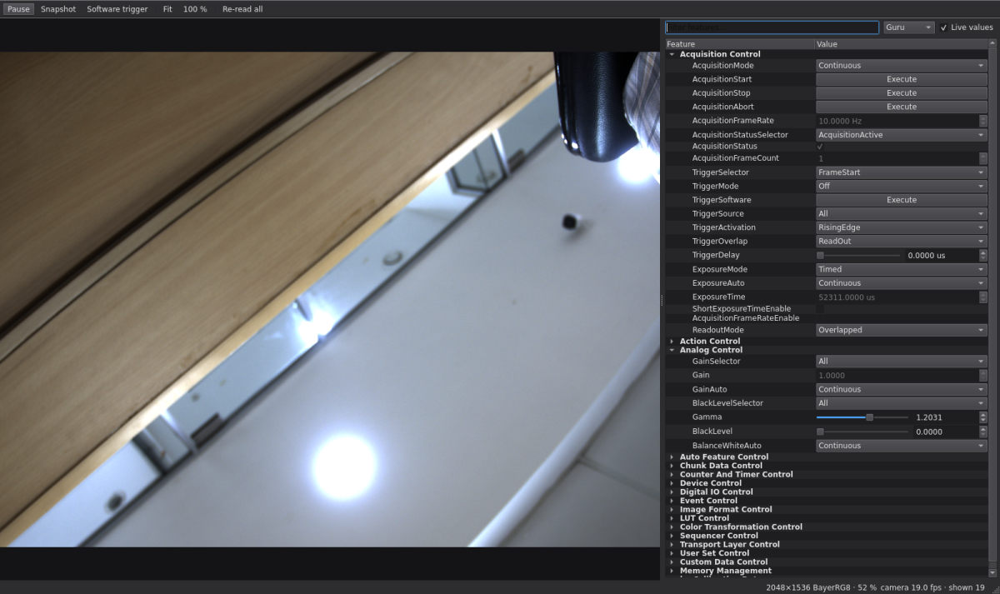

# baumer-neoapi-tools

Python tools for Baumer GigE Vision cameras using the Baumer **neoAPI**:

| Script | What it does |
|---|---|
| `camera_gui.py` | Live view plus every camera feature, with a control for each, grouped like Baumer Camera Explorer |
| `capture_cv.py` | Grab frames with neoAPI and show/save them with OpenCV (headless mode, FPS readout, exposure override) |
| `smoke.py` | Connects to the first camera and grabs one frame: a quick "does it work" check |

Tested with a Baumer VCXG.2-32C (IMX265, 2048×1536, BayerRG8) on Ubuntu x86_64, Python 3.10, neoAPI 1.6.0.



## Downloads

| Software | Needed for | Link |
|---|---|---|
| Baumer neoAPI for Python (Linux x86_64) | all scripts | [download](https://share.baumer.com/link/LOGs9VX19zsMViE1Y5JYgK) |
| Baumer Camera Explorer | optional: check the camera is visible, set its IP, update firmware | [download](https://share.baumer.com/link/YZPn1sBxVLBYYSheOmpn8l) |

## Setup

1. **neoAPI** is not on PyPI. Download *Baumer neoAPI for Python* (Linux x86_64, tested with 1.6.0)
   from [Baumer's download share](https://share.baumer.com/link/LOGs9VX19zsMViE1Y5JYgK),
   unpack it, and install the wheel:
   ```bash
   conda create -n ds-neoapi python=3.10
   conda activate ds-neoapi
   pip install Baumer_neoAPI_*/wheel/baumer_neoapi-*.whl
   pip install -r requirements.txt
   ```
2. **Network** (GigE cameras): give the camera's network port an IPv4 address in the camera's
   subnet. With no DHCP server on the link, the camera falls back to link-local `169.254.x.x`:
   ```bash
   nmcli con mod "<camera connection>" ipv4.method manual ipv4.addresses 169.254.1.1/16 \
       ipv4.never-default yes ipv6.method disabled
   nmcli con up "<camera connection>"
   ```
   For full-rate streaming, enable jumbo frames (MTU 9000) on that port and raise the socket
   receive buffers:
   ```bash
   sudo sysctl -w net.core.rmem_max=33554432 net.core.rmem_default=33554432
   ```

Only one application can control a GigE camera at a time: disconnect it in Camera Explorer
(or close other scripts) before running these.

## camera_gui.py

```bash
python camera_gui.py                       # first camera found
python camera_gui.py --serial 700011878780 # a specific camera
```

- **Live view**: mouse wheel zooms, drag pans, double-click fits; the status bar shows the pixel
  value under the cursor and camera / display FPS.
- **Feature panel**: built from the camera itself (its GenICam XML), so it works with any model.
  Number fields with sliders (log-scaled for exposure), drop-downs, check boxes, Execute buttons
  and text fields for IP/MAC/hex values. Names are the ones used in code
  (`cam.f.ExposureTime`, `"BayerRG8"`); hover a feature for its description. Filter by name and
  by visibility level (Beginner / Expert / Guru).
- **Toolbar**: Pause (Space), Snapshot (Ctrl+S, full-resolution PNG to `snapshots/`),
  Software trigger, Fit (F), 100 % (1), Re-read all (F5).
- Greyed-out features are read-only or locked by another setting, e.g. `ExposureTime` while
  `ExposureAuto` is not `Off`.
- Factory reset, reboot, user-set save and IP configuration changes ask for confirmation.

Settings are lost at power-off unless saved: choose `UserSet1` in `UserSetSelector`, press
`UserSetSave`, and set `UserSetDefault` to `UserSet1`.

### Implementation notes

- Frames are grabbed and converted on one thread; all feature reads/writes run on another,
  so the window never blocks (some reads take 20–50 ms, and a full read of ~250 features ~0.7 s).
  Writes take priority over reads, and slider drags collapse to the newest value.
- In neoAPI 1.6, `Feature.IsWritable()` takes ~100 ms per feature **while streaming** but ~0 ms
  when stopped. The GUI therefore checks write access for all features in one pass with the
  stream paused (~0.25 s), and only after enum / boolean / command writes (modes and selectors
  are what lock or unlock other features). Number changes never pause the stream.
- Exiting Python while a thread is inside `GetImage()` aborts the process, so the GUI stops its
  threads before disconnecting.
- PySide6 is pinned to 6.4.3: Qt ≥ 6.5 needs the `libxcb-cursor0` system package. With that
  installed (`sudo apt install libxcb-cursor0`) newer PySide6 versions work too.

## capture_cv.py

```bash
python capture_cv.py                         # live window
python capture_cv.py --exposure-us 8000      # manual exposure (turns ExposureAuto off)
python capture_cv.py --no-display --frames 100 --save-dir ./frames --save-every 25
python capture_cv.py --synthetic             # no camera: test the OpenCV side only
```

Window keys: `q` / `Esc` quit, `s` saves the current frame.
